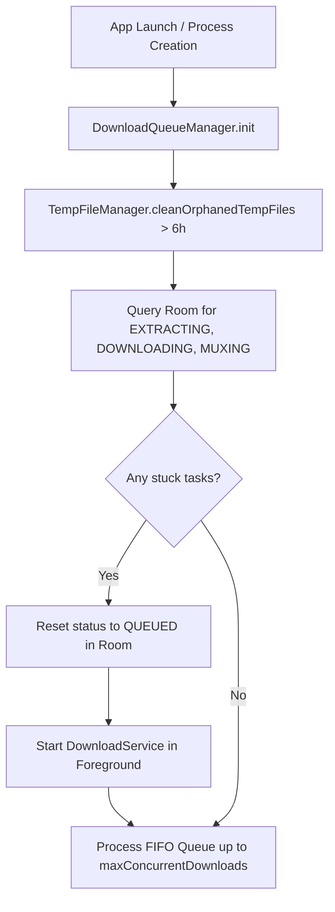

# Process Death & Resilience Strategy — Personal Media Saver

## 1. Context and Problem Statement
Android background execution is subject to aggressive process lifecycle management:
1. **Low Memory Killer (LMK)**: The operating system terminates background processes to reclaim memory for foreground applications.
2. **User Task Clearance**: The user may swipe the app out of the Recents screen while a large video download or audio/video muxing operation is in progress.
3. **App Restart**: Device reboots, app updates, or crash restarts leave in-flight operations half-finished.

Without an explicit strategy, interrupted downloads result in:
- Orphaned temporary files consuming gigabytes of internal storage.
- Tasks permanently stuck in `DOWNLOADING` or `MUXING` state in the UI.
- Corrupted, unplayable media files in the user's gallery.

---

## 2. Architectural Pillars of Recovery

### Pillar 1: Foreground Service with `dataSync` Type
- **Implementation**: `com.mediasaver.core.download.service.DownloadService`
- **Foreground Type**: `android:foregroundServiceType="dataSync"`
- **Impact**: Keeps the process at a low `oom_adj` score, preventing Android from killing the worker process during normal background multitasking.
- **Service Restart**: `onStartCommand` returns `START_STICKY`, ensuring the Android framework restarts the service when memory pressure subsides.

### Pillar 2: Room Database as Single Source of Truth
- Every download task is persisted to Room (`DownloadEntity`) upon queueing.
- State transitions are atomic:
  $$\text{QUEUED} \longrightarrow \text{EXTRACTING} \longrightarrow \text{DOWNLOADING} \longrightarrow \text{MUXING} \longrightarrow \text{COMPLETED}$$
- At no point is task existence or progress maintained solely in memory.
- If the process terminates at any millisecond, the persistent database records the exact task ID, source URL, target filenames, and stream configuration.

### Pillar 3: Cold Start & Process Recovery (`recoverQueueState()`)
When the application boots or `DownloadQueueManager` is instantiated by Hilt:
1. **Temporary File Sweep**: `tempFileManager.cleanOrphanedTempFiles(maxAgeMillis = 6 * 60 * 60 * 1000L)` deletes any dangling `.tmp` files older than 6 hours.
2. **Interrupted Task Reset**: Queries Room for any task in an active state (`EXTRACTING`, `DOWNLOADING`, `MUXING`). Because the process just started, any task in these states was abruptly interrupted.
3. **State Rollback**: Interrupted tasks are updated to `QUEUED`.
4. **Foreground Restart**: If active tasks exist, `DownloadService.start(context)` is invoked immediately.
5. **Queue Scheduling**: `processNextInQueue()` schedules eligible tasks in FIFO order according to `maxConcurrentDownloads` (default 3).

### Pillar 4: Atomic Gallery Insertion
- In-progress downloads write exclusively to `context.cacheDir/downloads/<downloadId>.tmp`.
- Media files are **never** written directly to the public gallery while downloading.
- Only upon complete, verified stream download and successful FFmpeg muxing is the file atomically inserted into `MediaStore` using `IS_PENDING = 0`.
- If a crash occurs, no 0-byte or corrupted video ever appears in the user's Gallery or Photos app.

### Pillar 5: Intelligent Automatic Retry with Exponential Backoff
- In case of transient network loss or server resets, `RetryPolicy` implements an exponential backoff schedule:
  $$\text{Delays: } 1\text{s} \to 2\text{s} \to 4\text{s} \to 8\text{s} \to 16\text{s} \to 32\text{s}$$
- HTTP 429 rate-limiting triggers an extended 30-second backoff delay.
- Maximum 3 automatic retries per task.
- Non-retryable errors (HTTP 404, 403, 401, InvalidUrl, StorageFull, UnsupportedPlatform) fail fast without draining battery or CPU.
- Manual retry by the user is **always** allowed and resets the retry counter.
