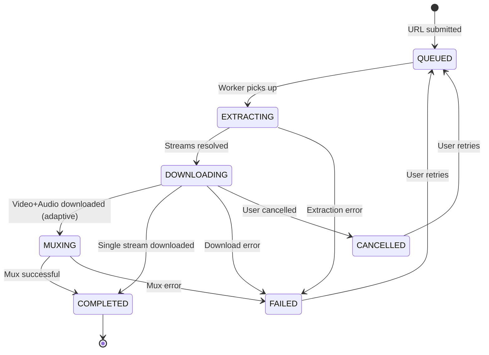
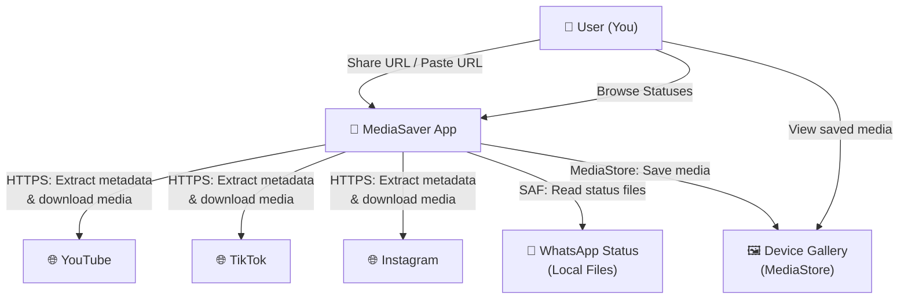
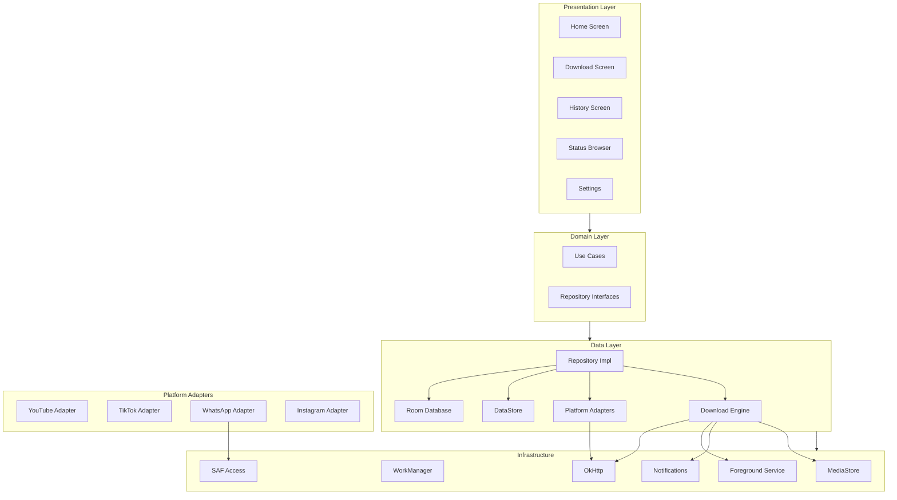
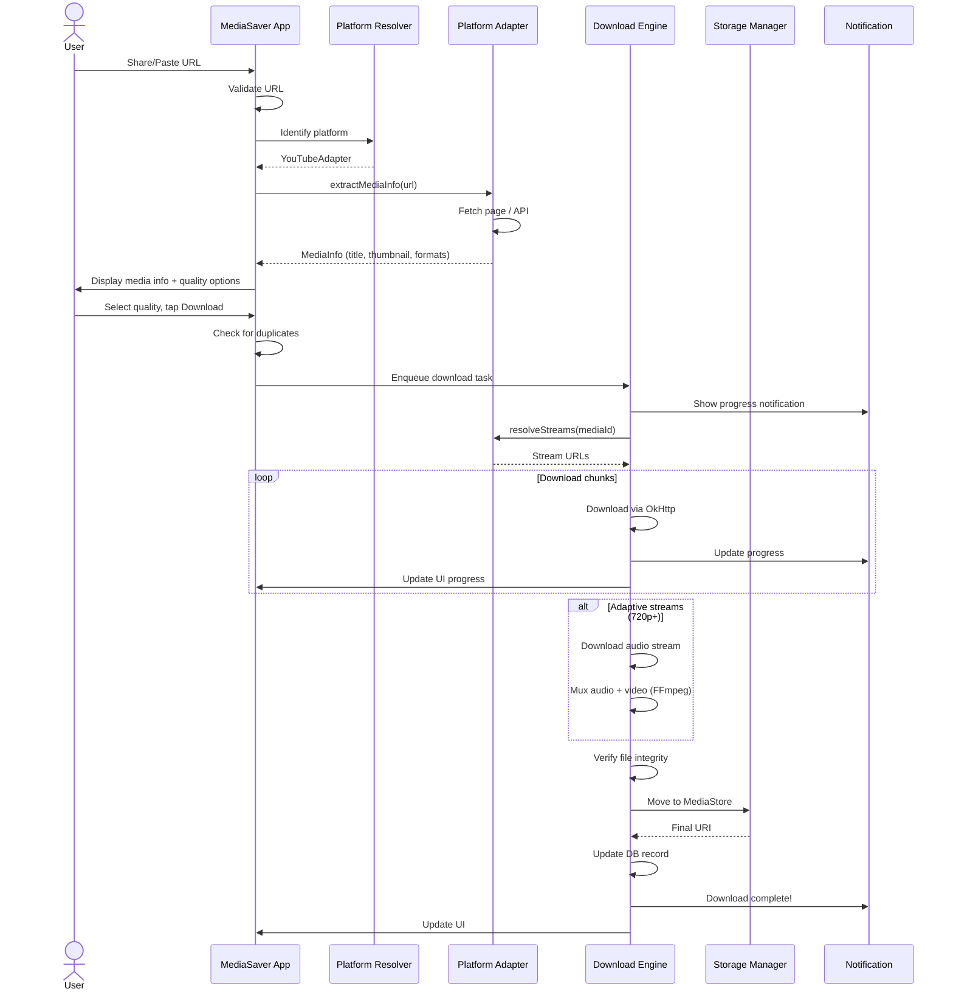
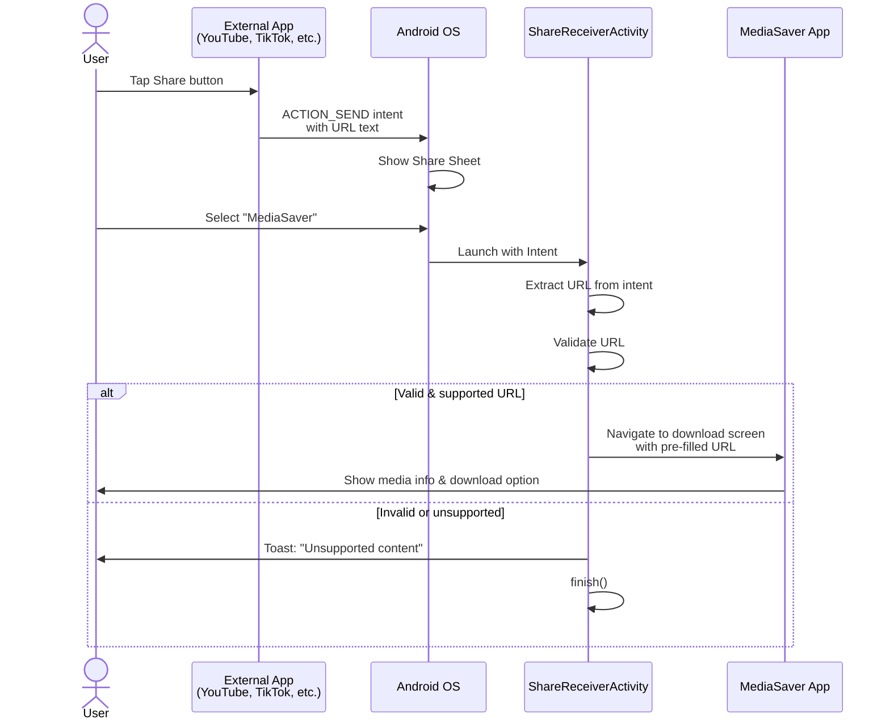
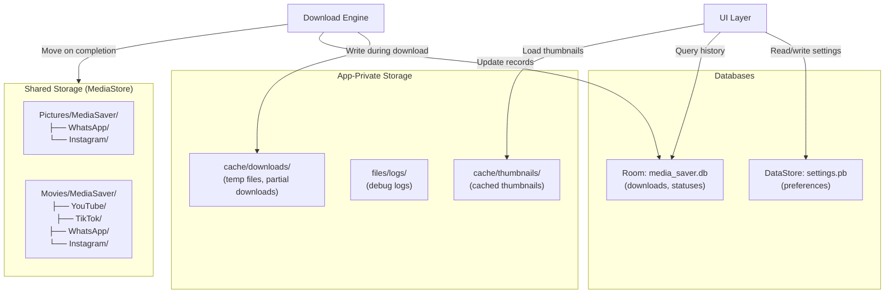
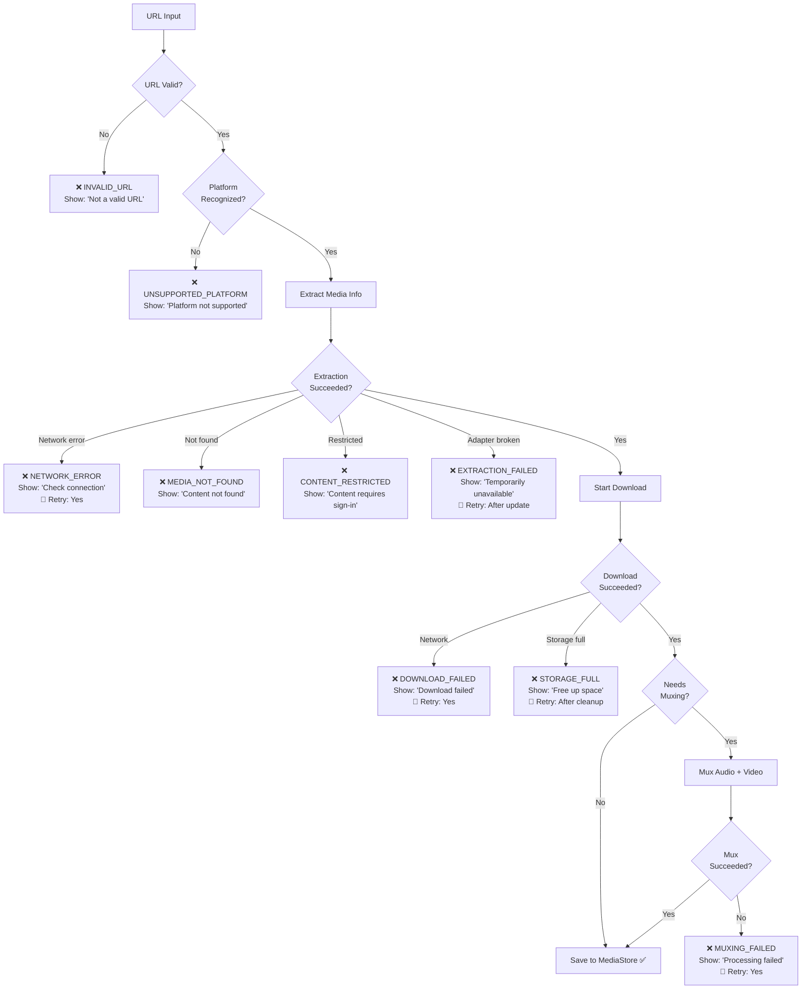

# Personal Media Saver — Architecture & System Design

> A comprehensive architectural analysis and design document for a private, personal-use Android media-saving utility.

---

## PHASE 1 — IDEA REVIEW

### Strengths

1. **Clear personal-use scope** — eliminates entire categories of enterprise complexity (auth, multi-tenancy, billing, cloud infra).
2. **Well-defined domain** — media downloading is a constrained problem with known patterns.
3. **Modular by nature** — each platform is an independent integration, naturally lending itself to adapter-based architecture.
4. **Single user = simple deployment** — sideload an APK, done. No Play Store review process to worry about.
5. **Local-first aligns with privacy goals** — no external data collection needed whatsoever.

### Weaknesses & Assumptions Challenged

| Assumption | Challenge | Reality |
|---|---|---|
| "All platforms can be downloaded from" | Platforms actively combat automated downloading | Instagram, TikTok, and YouTube all employ anti-bot measures, dynamic rendering, and rate limiting |
| "A single app can handle all platforms uniformly" | Each platform has fundamentally different access patterns | WhatsApp = local file access; YouTube = complex stream extraction; Instagram/TikTok = web scraping with anti-bot |
| "On-device processing is sufficient" | Some stream extraction is computationally intensive and requires up-to-date extraction logic | YouTube extraction logic changes frequently; on-device is possible but requires frequent app updates |
| "Simple URL → download" | Many platforms serve media through authenticated, tokenized, or expiring URLs | Extracted download URLs may expire within minutes |
| "This will remain stable" | Platform changes are frequent and unpredictable | Any platform integration can break at any time with zero notice |

### Risks

1. **Fragility** — Platform integrations WILL break. This is not "if" but "when." The architecture must treat breakage as a normal operating condition.
2. **Legal ambiguity** — While personal use has defensible arguments in many jurisdictions, downloading copyrighted content exists in a gray area. The app should never bypass DRM, authentication, or access controls.
3. **WhatsApp Status access** — Android 11+ Scoped Storage restrictions have made `.Statuses` folder access significantly harder. Requires SAF (Storage Access Framework) user grant.
4. **YouTube complexity** — YouTube is the most technically complex target. Stream extraction requires maintaining parity with YouTube's obfuscation changes (JavaScript player parsing, signature decryption, throttling countermeasures).
5. **Maintenance burden** — Every platform adapter is a living dependency that requires ongoing updates.

### Improvements Proposed

1. **Design for degradation** — Each platform adapter should have a health status. When a platform breaks, the app should clearly communicate this rather than failing silently.
2. **Leverage existing extraction libraries** — Don't reinvent stream extraction. Use battle-tested libraries (yt-dlp concepts) rather than writing custom parsers.
3. **Separate extraction logic from app logic** — Platform extraction code should be updatable independently of the main app where possible.
4. **Accept that some platforms may only be "partially supported"** — Don't promise uniform behavior across all platforms.
5. **Prioritize WhatsApp and YouTube** — These have the most mature technical approaches and the highest personal utility.

---

## PHASE 2 — TECHNICAL FEASIBILITY

### WhatsApp Status

#### A. Input
- **Local file detection** via Storage Access Framework (SAF).
- On Android 10 and below: direct file path access to `/storage/emulated/0/WhatsApp/Media/.Statuses/` (or the equivalent for WhatsApp Business).
- On **Android 11+**: the `.Statuses` directory is no longer directly accessible due to Scoped Storage. The user must grant persistent SAF access to the WhatsApp Status directory via `ACTION_OPEN_DOCUMENT_TREE`. The app then uses the persisted URI permission to enumerate and copy status files.

#### B. Processing
- Enumerate files in the granted directory (images: `.jpg`, videos: `.mp4`).
- Generate thumbnails for preview.
- Copy selected files to the app's managed storage location.
- Detect duplicates via file hash (MD5/SHA-256) or filename + size.

#### C. Storage
- Copy to shared media storage via `MediaStore` (appears in Gallery).
- Organized subfolder: `Pictures/MediaSaver/WhatsApp/` and `Movies/MediaSaver/WhatsApp/`.

#### D. Permissions
- `READ_MEDIA_IMAGES`, `READ_MEDIA_VIDEO` (Android 13+).
- SAF persistent URI permission for the `.Statuses` directory (Android 11+).
- No `MANAGE_EXTERNAL_STORAGE` needed (avoids Play Store policy issues, though this app won't be published).

#### E. Limitations
- **Android 11+ SAF grant is one-time but manual** — user must navigate to the correct directory in the SAF picker.
- WhatsApp may change the `.Statuses` directory path or structure.
- WhatsApp Business uses a different directory (`WhatsApp Business/Media/.Statuses/`).
- Statuses are ephemeral (24h) — the app can only see currently available statuses.
- Encrypted backups are NOT accessible.

#### F. Reliability
> **Moderately Reliable** — SAF-based access works reliably once granted, but depends on WhatsApp's unchanged directory structure. WhatsApp could move to app-scoped storage in the future.

#### G. Maintenance
- Monitor WhatsApp directory structure changes across updates.
- Adapt to new Android storage API changes.
- Low ongoing maintenance if SAF approach is used correctly.

---

### YouTube

#### A. Input
- **URL sharing** via Android Share Sheet (most common — user shares from YouTube app).
- **URL paste** — manual paste into the app.
- **Clipboard detection** — optional, detect YouTube URLs on clipboard when app opens.
- Supported URL formats: `youtube.com/watch?v=`, `youtu.be/`, `youtube.com/shorts/`, `youtube.com/live/`, `m.youtube.com/`.

#### B. Processing

This is the most technically complex platform. The processing pipeline:

1. **URL parsing** — Extract video ID from various URL formats.
2. **Metadata extraction** — Fetch video title, thumbnail, duration, available formats.
3. **Stream extraction** — Resolve actual media stream URLs. This involves:
   - Fetching the video page or innertube API response.
   - Parsing the player configuration.
   - Deciphering signature-protected stream URLs (YouTube obfuscates these).
   - Handling adaptive streams (separate audio + video) vs. progressive streams (muxed).
4. **Format selection** — Present available qualities to user (360p, 720p, 1080p, etc.).
5. **Download** — For adaptive streams, download video + audio separately, then mux with a library like FFmpeg (lightweight build).
6. **Muxing** — Combine audio + video streams into a single `.mp4` file (required for 720p+ content which is typically DASH-only).

**Technical approach options:**

| Approach | Pros | Cons |
|---|---|---|
| **Embed yt-dlp via Python/Chaquopy** | Battle-tested extraction, frequently updated | Heavy dependency (~50MB+), Python runtime overhead, complex integration |
| **Port extraction logic to Kotlin** | Native performance, no runtime overhead | Enormous maintenance burden to keep up with YouTube changes |
| **Use NewPipe Extractor library** | Java/Kotlin native, well-maintained open-source, designed for Android | External dependency, must track upstream updates |
| **Use lightweight HTTP-based extraction** | Minimal dependencies | Fragile, will break frequently |

**Recommended: NewPipe Extractor** (`org.schabi.newpipe:NewPipeExtractor`) — this is a Java library specifically designed for extracting stream information from YouTube (and other platforms) on Android. It's actively maintained by the NewPipe community and handles the complex signature deciphering.

#### C. Storage
- Downloaded files stored via `MediaStore` to `Movies/MediaSaver/YouTube/`.
- Temporary/partial downloads in app-private cache directory.
- Muxed output replaces temporary files.

#### D. Permissions
- `INTERNET` — required.
- `FOREGROUND_SERVICE` + `FOREGROUND_SERVICE_DATA_SYNC` — for background downloads.
- `POST_NOTIFICATIONS` (Android 13+) — for download progress/completion notifications.
- `READ_MEDIA_VIDEO` (Android 13+) — if the app needs to verify stored files.

#### E. Limitations

> [!WARNING]
> YouTube actively combats third-party downloading. The following limitations are significant:

- **Signature deciphering changes frequently** — YouTube updates its JavaScript player regularly, breaking extraction logic.
- **Age-restricted content** requires authentication — NOT supported (would require Google account credentials).
- **DRM-protected content** (YouTube Premium originals) — NOT supported and must NOT be attempted.
- **Rate limiting / throttling** — YouTube throttles downloads from non-browser clients. NewPipe Extractor includes countermeasures but these are a cat-and-mouse game.
- **Live streams** — downloading live streams is significantly more complex (HLS/DASH segmented).
- **High-quality formats (1080p+)** are adaptive-only — require separate audio+video download and muxing (FFmpeg dependency).
- **Geo-restricted content** — some videos are unavailable in certain regions.

#### F. Reliability
> **Moderately Reliable / Fragile** — Works well when the extraction library is up-to-date, but can break at any YouTube update. Requires the extraction library dependency to be updated regularly. Expect breakage every few months.

#### G. Maintenance
- **HIGH maintenance** — Must update NewPipe Extractor dependency frequently (monthly or more).
- Monitor for YouTube API/player changes.
- FFmpeg muxing component is stable and requires minimal maintenance.
- URL parsing is stable.

---

### Instagram

#### A. Input
- **URL sharing** via Android Share Sheet (from Instagram app).
- **URL paste** — manual paste.
- Supported: `instagram.com/p/`, `instagram.com/reel/`, `instagram.com/stories/` (public only).

#### B. Processing

1. **URL parsing** — Extract post/reel shortcode.
2. **Metadata extraction** — Fetch media information.
   - **oEmbed API** (`https://api.instagram.com/oembed/?url=...`) — Returns limited metadata (title, thumbnail URL, author) for public posts. Does NOT return direct media download URLs.
   - **GraphQL endpoint** — Instagram's internal GraphQL API can return media URLs for public posts, but this is undocumented, unauthenticated access is heavily rate-limited, and Instagram actively blocks automated access.
   - **Web scraping** — Fetch the post page HTML and extract embedded JSON data (`window.__additionalDataLoaded` or similar). Instagram has moved to client-side rendering, making this increasingly difficult.
3. **Download** — Download the resolved media URL.

**Technical reality:**

> [!CAUTION]
> Instagram is one of the **hardest platforms** to support reliably. Meta has aggressively locked down automated access. Public posts can sometimes be accessed via web scraping, but this is fragile and rate-limited. Private content, stories (non-public), and most reels require authentication.

| Approach | Feasibility |
|---|---|
| oEmbed API | Works for metadata only, NOT for media download URLs |
| Web scraping | Fragile — Instagram uses React SSR with anti-bot measures, rate limiting, and IP blocking |
| GraphQL API (unauthenticated) | Heavily rate-limited, may require session cookies, breaks frequently |
| Official Instagram Graph API | Requires Facebook Developer account, only for your own content or content from accounts that authorize your app |

**Recommendation:** Support Instagram as **"Partially Supported"** — it may work for some public posts but reliability cannot be guaranteed. Use web page parsing with embedded JSON extraction as the primary approach, with graceful fallback to "unsupported" status.

#### C. Storage
- `Pictures/MediaSaver/Instagram/` for images.
- `Movies/MediaSaver/Instagram/` for videos/reels.

#### D. Permissions
- `INTERNET`.
- Same download-related permissions as YouTube.

#### E. Limitations
- Private content: **NOT accessible** without authentication (which we should not implement).
- Stories: Only public stories, and they expire in 24h.
- Carousel posts: Multiple images/videos in one post — need to handle multi-media.
- Reels: May be treated differently than regular posts.
- Rate limiting: Instagram aggressively blocks automated requests.
- Anti-bot: CAPTCHAs, JavaScript challenges, IP blocking.

#### F. Reliability
> **Fragile** — Can break at any Instagram update. Expect frequent failures and periods of non-functionality.

#### G. Maintenance
- **HIGH maintenance** — Web scraping approaches require constant adaptation.
- Instagram changes its page structure and API endpoints regularly.
- May require updating User-Agent strings, cookie handling, and anti-bot countermeasures.

---

### TikTok

#### A. Input
- **URL sharing** via Android Share Sheet (from TikTok app — this is the most natural flow).
- **URL paste** — manual paste.
- Supported: `tiktok.com/@user/video/`, `vm.tiktok.com/` (short URLs).

#### B. Processing

1. **URL resolution** — TikTok short URLs (`vm.tiktok.com/...`) redirect to full URLs. Follow redirects to get the canonical URL with the video ID.
2. **Metadata extraction** — Fetch video information.
   - **oEmbed API** (`https://www.tiktok.com/oembed?url=...`) — Returns metadata (title, author, thumbnail) but NOT direct video download URLs.
   - **Web page parsing** — TikTok embeds video data in a `<script id="__UNIVERSAL_DATA_FOR_REHYDRATION__">` JSON blob. This can be parsed to extract the video download URL.
   - **Direct API** — TikTok's internal API endpoints can return video data, but these are undocumented and change.
3. **Watermark handling** — TikTok videos served through their API typically have a watermark. The non-watermarked URL is sometimes available in the page data but this is inconsistent.
4. **Download** — Download the video file.

**Technical reality:**
TikTok is more accessible than Instagram for public video extraction. The web page parsing approach works reasonably well for public videos. NewPipe Extractor also supports TikTok extraction.

#### C. Storage
- `Movies/MediaSaver/TikTok/`.

#### D. Permissions
- Same as YouTube/Instagram.

#### E. Limitations
- Private videos: **NOT accessible**.
- Videos from private accounts: **NOT accessible**.
- Watermarks: Removed watermark versions may not always be available.
- Slideshows (photo carousels): Different handling than videos.
- Region-restricted content: Some videos may not be available in all regions.
- Rate limiting: TikTok rate-limits automated access.

#### F. Reliability
> **Moderately Reliable** — Web page parsing works reasonably well for public TikTok videos. NewPipe Extractor provides maintained support. Less fragile than Instagram but still subject to change.

#### G. Maintenance
- **MODERATE maintenance** — Less volatile than Instagram, but still requires updates when TikTok changes its page structure.
- NewPipe Extractor handles much of the maintenance burden if used.

---

### Platform Feasibility Summary

| Platform | Feasibility | Reliability | Maintenance | MVP Priority |
|---|---|---|---|---|
| **WhatsApp Status** | ✅ High | Moderate | Low | ✅ Yes |
| **YouTube** | ✅ High (with library) | Moderate/Fragile | High | ✅ Yes |
| **Instagram** | ⚠️ Partial | Fragile | High | ❌ V1 |
| **TikTok** | ✅ Moderate | Moderate | Moderate | ✅ Yes |

---

## PHASE 3 — PRODUCT DEFINITION

### Problem
Saving media from multiple platforms requires switching between multiple apps, dealing with ads/bloatware in third-party downloaders, or performing tedious manual steps. A single, clean, private utility would consolidate these workflows.

### Solution
A personal Android application that:
- Acts as a unified share target for media URLs.
- Detects and saves WhatsApp Status media.
- Downloads public media from supported platforms.
- Stores everything in organized local storage.
- Provides a clean, ad-free, private experience.

### Target User
One person — the developer/owner. No multi-user considerations.

### Core Workflows

**Workflow 1 — Share Sheet Download:**
```
User sees content → Shares URL to app → App processes → User confirms → Download completes
```

**Workflow 2 — Manual URL Input:**
```
User opens app → Pastes URL → App processes → User confirms → Download completes
```

**Workflow 3 — WhatsApp Status Save:**
```
User opens Status tab → Browses available statuses → Selects items → Saves to gallery
```

### MVP Scope

| Feature | Included |
|---|---|
| Share Sheet URL receiving | ✅ |
| Manual URL paste | ✅ |
| Platform detection (YouTube, TikTok) | ✅ |
| YouTube download (up to 1080p with muxing) | ✅ |
| TikTok video download | ✅ |
| WhatsApp Status browsing & saving | ✅ |
| Download progress & notifications | ✅ |
| Basic download history | ✅ |
| Local organized storage | ✅ |
| Quality/format selection (YouTube) | ✅ |
| Duplicate detection (hash-based) | ✅ |
| Error handling with user-friendly messages | ✅ |

### V1 Scope

| Feature | |
|---|---|
| Instagram support (partial/best-effort) | ✅ |
| Clipboard URL detection | ✅ |
| Download retry with exponential backoff | ✅ |
| Batch downloads (multiple URLs) | ✅ |
| Advanced file management (search, filter) | ✅ |
| Customizable filename templates | ✅ |
| Wi-Fi-only download option | ✅ |
| Storage usage statistics | ✅ |
| Dark/light theme | ✅ |

### Future Scope

| Feature | |
|---|---|
| Additional platforms (Twitter/X, Reddit, Facebook) | 🔮 |
| Browser extension companion | 🔮 |
| Download scheduling | 🔮 |
| Audio-only extraction (YouTube → MP3) | 🔮 |
| Batch import from text file | 🔮 |
| Cross-device sync (local network) | 🔮 |
| Desktop companion app | 🔮 |
| Subtitle/caption download | 🔮 |

---

## PHASE 4 — SYSTEM REQUIREMENTS

### Functional Requirements

#### FR-1: Media Input
- **FR-1.1**: Accept URLs via Android Share Sheet from any application.
- **FR-1.2**: Accept URLs via manual text input field.
- **FR-1.3**: Validate URL format before processing.
- **FR-1.4**: Automatically detect the platform from the URL domain.
- **FR-1.5**: Display "unsupported platform" for unrecognized URLs.
- **FR-1.6**: (WhatsApp) Browse available Status media via SAF-granted directory access.

#### FR-2: Media Processing
- **FR-2.1**: Extract media metadata (title, duration, thumbnail, format, size where available).
- **FR-2.2**: Resolve actual downloadable media URLs via platform-specific extraction.
- **FR-2.3**: Present available quality/format options to the user (YouTube).
- **FR-2.4**: Handle URL redirects (TikTok short URLs).
- **FR-2.5**: Detect carousel/multi-media content and present all items.

#### FR-3: Download Management
- **FR-3.1**: Download media files via HTTP(S).
- **FR-3.2**: Display download progress (percentage, speed, ETA).
- **FR-3.3**: Support download cancellation.
- **FR-3.4**: Support download retry on failure.
- **FR-3.5**: Queue multiple downloads.
- **FR-3.6**: Continue downloads in background via Foreground Service.
- **FR-3.7**: Show download status in system notification.
- **FR-3.8**: (YouTube 720p+) Perform audio+video muxing after download.

#### FR-4: Storage
- **FR-4.1**: Save completed downloads to organized folders in shared storage via MediaStore.
- **FR-4.2**: Organize files by platform (`MediaSaver/YouTube/`, `MediaSaver/TikTok/`, etc.).
- **FR-4.3**: Generate meaningful filenames from media metadata.
- **FR-4.4**: Detect duplicate downloads via content hash before saving.
- **FR-4.5**: Clean up temporary/partial files on failure or cancellation.
- **FR-4.6**: Maintain a download history database.

#### FR-5: Media Management
- **FR-5.1**: Display download history with thumbnails and metadata.
- **FR-5.2**: Open downloaded media in default viewer/gallery.
- **FR-5.3**: Share downloaded media via Android Share Sheet.
- **FR-5.4**: Delete downloaded files (with confirmation).
- **FR-5.5**: Preview media (thumbnail or inline player).

#### FR-6: Settings
- **FR-6.1**: Configure preferred download quality (YouTube).
- **FR-6.2**: Configure download directory (via SAF picker).
- **FR-6.3**: (V1) Wi-Fi-only download toggle.
- **FR-6.4**: (V1) Customizable filename template.
- **FR-6.5**: View and manage storage usage.
- **FR-6.6**: Clear download history.
- **FR-6.7**: Re-grant WhatsApp Status directory access.

### Non-Functional Requirements

#### NFR-1: Performance
- **NFR-1.1**: App cold start under 2 seconds.
- **NFR-1.2**: URL processing and metadata display under 5 seconds on reasonable network.
- **NFR-1.3**: Support downloading files up to 2GB.
- **NFR-1.4**: Concurrent download limit: 3 simultaneous downloads (configurable).
- **NFR-1.5**: Efficient memory usage — avoid loading entire files into memory; use streaming I/O.

#### NFR-2: Security
- **NFR-2.1**: Validate and sanitize all incoming URLs (prevent injection, path traversal).
- **NFR-2.2**: Validate downloaded file types against expected MIME types.
- **NFR-2.3**: Use HTTPS for all network requests.
- **NFR-2.4**: Sanitize filenames to prevent path traversal or special character issues.
- **NFR-2.5**: Set maximum download size limit (configurable, default 2GB).
- **NFR-2.6**: Validate redirect chains (maximum 5 redirects, no redirect to local addresses).
- **NFR-2.7**: No credentials stored for any external platform.

#### NFR-3: Privacy
- **NFR-3.1**: Zero analytics, zero tracking, zero telemetry.
- **NFR-3.2**: No crash reporting to external services.
- **NFR-3.3**: All data stored locally on device only.
- **NFR-3.4**: No user accounts or authentication.
- **NFR-3.5**: Network requests only to target platforms for content extraction/download.
- **NFR-3.6**: No advertising SDKs.
- **NFR-3.7**: Local-only logging (debug builds only).

#### NFR-4: Reliability
- **NFR-4.1**: Graceful handling of network failures with clear error messages.
- **NFR-4.2**: Graceful handling of platform API changes (show "temporarily unavailable" rather than crashing).
- **NFR-4.3**: Survive process death — resume or re-queue pending downloads.
- **NFR-4.4**: Handle insufficient storage gracefully.
- **NFR-4.5**: Handle Android permission revocations gracefully.

---

## PHASE 5 — ARCHITECTURE OPTIONS

### Architecture A: Completely On-Device

```
┌─────────────────────────────────────┐
│          Android Device             │
│                                     │
│  ┌────────────┐  ┌───────────────┐  │
│  │ UI (Compose)│  │ Download Eng. │  │
│  └─────┬──────┘  └───────┬───────┘  │
│        │                 │          │
│  ┌─────┴─────────────────┴───────┐  │
│  │     Platform Adapters         │  │
│  │  (YouTube, TikTok, WhatsApp)  │  │
│  └───────────────┬───────────────┘  │
│                  │                  │
│  ┌───────────────┴───────────────┐  │
│  │   Local Storage (Room + FS)   │  │
│  └───────────────────────────────┘  │
└─────────────────────────────────────┘
         │ HTTPS only
         ▼
   External Platforms
   (youtube.com, tiktok.com, etc.)
```

| Criterion | Rating | Notes |
|---|---|---|
| Complexity | ⭐ Low | Single application, no backend |
| Cost | ⭐ \$0 | No servers, no cloud services |
| Privacy | ⭐⭐⭐ Maximum | Nothing leaves device except platform requests |
| Performance | ⭐⭐ Good | Limited by device CPU for muxing |
| Reliability | ⭐⭐ Good | No server dependency; platform extraction runs locally |
| Maintenance | ⭐⭐ Moderate | Must update app for extraction logic changes |
| Scalability | N/A | Single user |
| Infrastructure | ⭐⭐⭐ None | Zero infrastructure |

### Architecture B: Mobile + Lightweight Backend

```
┌──────────────────┐         ┌─────────────────────┐
│  Android App     │  HTTPS  │  Lightweight Server  │
│  (UI + Storage)  │ ◄─────► │  (Extraction API)    │
│                  │         │  (VPS / Raspberry Pi) │
└──────────────────┘         └─────────────────────┘
                                      │
                                      ▼
                              External Platforms
```

| Criterion | Rating | Notes |
|---|---|---|
| Complexity | ⭐⭐ Medium | Two systems to maintain |
| Cost | ⭐⭐ Low | ~\$5-10/month VPS or free Raspberry Pi |
| Privacy | ⭐⭐ Good | Backend is self-hosted, but URLs transit through server |
| Performance | ⭐⭐⭐ Best | Server can handle heavy extraction/muxing |
| Reliability | ⭐⭐ Good | Server-side extraction can be updated without app update |
| Maintenance | ⭐⭐ Moderate | Two codebases; but extraction updates don't require APK rebuild |
| Scalability | N/A | Single user |
| Infrastructure | ⭐⭐ Minimal | One server (VPS, home server, or Raspberry Pi) |

### Architecture C: Mobile + Specialized Cloud Service

```
┌──────────────────┐         ┌─────────────────────┐
│  Android App     │  HTTPS  │  Cloud Functions     │
│  (UI + Storage)  │ ◄─────► │  (AWS Lambda /       │
│                  │         │   Cloud Run / etc.)   │
└──────────────────┘         └─────────────────────┘
                                      │
                                      ▼
                              External Platforms
```

| Criterion | Rating | Notes |
|---|---|---|
| Complexity | ⭐⭐⭐ High | Cloud infra, deployment pipelines, API gateway |
| Cost | ⭐⭐ Variable | Pay-per-use, could be cheap or expensive depending on usage |
| Privacy | ⭐ Lower | URLs and metadata transit through third-party cloud |
| Performance | ⭐⭐⭐ Best | Cloud compute for extraction |
| Reliability | ⭐⭐ Good | Cloud availability is high, but adds network dependency |
| Maintenance | ⭐⭐⭐ High | Cloud infra, IaC, monitoring, billing |
| Scalability | N/A | Overkill for single user |
| Infrastructure | ⭐⭐⭐ Significant | Cloud account, billing, monitoring |

### Architecture Comparison Summary

| | **A: On-Device** | **B: Mobile + Backend** | **C: Mobile + Cloud** |
|---|---|---|---|
| Best for | Privacy, simplicity | Updatable extraction | Enterprise scale |
| Worst for | Extraction updates | Two systems to maintain | Cost, complexity |
| **Recommendation** | **✅ PRIMARY** | Fallback if A proves impractical | ❌ Overkill |

---

## PHASE 6 — RECOMMENDED ARCHITECTURE

### Decision: Architecture A — Completely On-Device

**With one strategic concession: the extraction library is an external dependency that must be kept updated.**

### Justification

1. **Privacy is maximized** — No backend means no server logs, no URL history on a remote system, no network transit of personal browsing data beyond the direct platform requests.

2. **Cost is zero** — No servers, no cloud bills, no infrastructure maintenance.

3. **Simplicity is maximized** — One codebase, one deployment target (sideloaded APK), one system to debug.

4. **The "backend advantage" is marginal for personal use** — Architecture B's main advantage (updating extraction logic without app rebuild) can be partially achieved by:
   - Using NewPipe Extractor as a dependency (updated via app rebuild).
   - Keeping platform adapters cleanly separated so updates are surgical.
   - Accepting that rebuilding and sideloading an APK takes ~2 minutes.

5. **Muxing on device is feasible** — Modern Android phones are powerful enough to mux audio+video via a lightweight FFmpeg build. A 10-minute 1080p video muxes in seconds on modern hardware.

6. **Single user eliminates all backend-driven requirements** — No auth, no rate limiting (app-level), no multi-tenant data isolation, no API gateway.

### Trade-offs Accepted

| Trade-off | Mitigation |
|---|---|
| Extraction logic requires APK rebuild to update | Clean adapter separation makes updates fast; sideloading is trivial |
| Device CPU handles muxing | Modern phones handle this easily; worst case is a few seconds delay |
| All processing happens on potentially slow mobile network | Acceptable — this is how the user's phone normally accesses the internet |
| No centralized logging | Local debug logs are sufficient for a single user |

---

## PHASE 7 — DETAILED SYSTEM ARCHITECTURE

### Application Layers

```
┌─────────────────────────────────────────────────┐
│                PRESENTATION LAYER               │
│   Jetpack Compose UI, ViewModels, Navigation    │
├─────────────────────────────────────────────────┤
│                 DOMAIN LAYER                    │
│   Use Cases, Domain Models, Repository Intf.    │
├─────────────────────────────────────────────────┤
│                  DATA LAYER                     │
│   Repositories, Platform Adapters, Download     │
│   Engine, Local Database, File Storage          │
├─────────────────────────────────────────────────┤
│              INFRASTRUCTURE LAYER               │
│   Android Services, WorkManager, Notifications  │
│   SAF, MediaStore, Network Client               │
└─────────────────────────────────────────────────┘
```

### Module Architecture

```
:app                    → Android application module, DI setup, navigation
:core:common            → Shared utilities, extensions, constants
:core:model             → Domain models (pure Kotlin, no Android deps)
:core:domain            → Use cases, repository interfaces
:core:data              → Repository implementations, data sources
:core:database          → Room database, DAOs, entities
:core:network           → HTTP client (OkHttp), network utilities
:core:download          → Download engine, queue management, muxing
:core:storage           → File storage, MediaStore integration, SAF
:platform:youtube       → YouTube extraction adapter
:platform:tiktok        → TikTok extraction adapter
:platform:whatsapp      → WhatsApp Status adapter
:platform:instagram     → Instagram extraction adapter (V1)
:feature:home           → Home screen UI
:feature:download       → Download screen & progress UI
:feature:history        → Download history UI
:feature:status         → WhatsApp Status browser UI
:feature:settings       → Settings UI
```

### Platform Adapter Interface

```kotlin
interface PlatformAdapter {
    val platformId: PlatformId
    val platformName: String
    
    /** Check if this adapter can handle the given URL */
    fun canHandle(url: String): Boolean
    
    /** Extract media information from the URL */
    suspend fun extractMediaInfo(url: String): Result<MediaInfo>
    
    /** Resolve the actual downloadable stream URL(s) */
    suspend fun resolveStreams(mediaId: String): Result<List<StreamInfo>>
    
    /** Health check — is this adapter currently functional? */
    suspend fun healthCheck(): AdapterStatus
}

enum class AdapterStatus {
    OPERATIONAL,
    DEGRADED,
    BROKEN,
    UNKNOWN
}
```

Each platform adapter implements this interface. The `PlatformResolver` uses `canHandle()` to route URLs to the correct adapter:

```kotlin
class PlatformResolver(private val adapters: List<PlatformAdapter>) {
    fun resolve(url: String): PlatformAdapter? =
        adapters.firstOrNull { it.canHandle(url) }
}
```

### Download Engine

```
┌──────────────────────────────────────────────────┐
│                DOWNLOAD ENGINE                   │
│                                                  │
│  ┌──────────┐  ┌───────────┐  ┌──────────────┐  │
│  │ Download  │  │ Download  │  │   Download   │  │
│  │  Queue    ├──► Workers   ├──►  Finalizer   │  │
│  │ Manager   │  │ (OkHttp)  │  │ (mux/verify) │  │
│  └──────────┘  └───────────┘  └──────────────┘  │
│       │              │               │           │
│       ▼              ▼               ▼           │
│  ┌──────────────────────────────────────────┐    │
│  │          State Management                │    │
│  │   (Room DB + StateFlow for UI)           │    │
│  └──────────────────────────────────────────┘    │
└──────────────────────────────────────────────────┘
```

**Queue Management:**
- Maximum 3 concurrent downloads (configurable).
- FIFO ordering with priority override capability.
- Persistent queue in Room — survives app restart.

**Download Worker:**
- Uses OkHttp for HTTP downloads with streaming I/O.
- Writes to app-private temporary directory during download.
- Reports progress via `StateFlow` to UI and notifications.
- Supports cancellation via coroutine cancellation.

**Retry Policy:**
- Exponential backoff: 1s → 2s → 4s → 8s → 16s → 32s.
- Maximum 3 automatic retries.
- Manual retry always available.
- Different retry behavior per error type:
  - Network timeout → Retry
  - 404 Not Found → No retry
  - 403 Forbidden → No retry (extraction may be broken)
  - 429 Too Many Requests → Retry with longer backoff
  - Storage full → No retry (user action needed)

**Muxing (YouTube 720p+):**
- After both audio and video streams download completely.
- Use mobile-ffmpeg (or FFmpegKit) for lightweight muxing.
- Runs on a background thread; progress reported to UI.
- Temporary audio/video files deleted after successful mux.

**Duplicate Detection:**
- Before download: Check URL + platform + mediaId against history.
- After download: Compare SHA-256 hash of downloaded content against stored hashes.
- User prompted if duplicate detected: "Already downloaded. Download again?"

**Temporary File Handling:**
- All in-progress downloads go to `context.cacheDir/downloads/`.
- On success: move to final location via MediaStore.
- On failure/cancel: delete temporary files.
- On app start: scan for orphaned temp files and clean up.

### Android Components

| Component | Purpose | Implementation |
|---|---|---|
| `MainActivity` | Single activity, hosts Compose navigation | `ComponentActivity` |
| `DownloadService` | Foreground service for active downloads | `LifecycleService` with notification |
| `ShareReceiverActivity` | Receives Share Sheet intents | Transparent activity, processes and dismisses |
| `WorkManager` | Cleanup tasks, orphan detection | Periodic worker |
| `NotificationManager` | Download progress, completion | Notification channels |
| `MediaStore` | Write files to shared storage | `ContentResolver` |
| `SAF` | WhatsApp Status directory access | `ActivityResultContracts.OpenDocumentTree` |

### Security Architecture

**Input Validation:**
```
URL Input → Scheme validation (https only) 
         → Domain allowlist check
         → Length limit (2048 chars)
         → Encoding validation
         → Path traversal check
         → Redirect chain limit (5)
```

**File Security:**
```
Downloaded file → MIME type validation (against expected type)
              → File size validation (against limit)
              → Filename sanitization (remove special chars, path separators)
              → Extension validation (allowlist: .mp4, .webm, .jpg, .png, .webp)
              → Write to app-private temp first, then move to final location
```

**Network Security:**
- All connections via HTTPS (OkHttp with default certificate validation).
- No custom certificate pinning (platforms rotate certs).
- Connection timeout: 30s, Read timeout: 60s.
- No cookies persisted between sessions.
- No credentials stored for any platform.

### Privacy Architecture

```
Data Flow:
  URL (from user) → Platform request (HTTPS) → Response (media data) → Local storage
  
What leaves device:
  ✓ HTTP requests to target platform (youtube.com, tiktok.com, etc.)
  ✓ Standard HTTP headers (User-Agent, Accept, etc.)
  
What NEVER leaves device:
  ✗ Download history
  ✗ Usage analytics
  ✗ Crash reports
  ✗ Personal data
  ✗ File metadata
  ✗ App settings
```

### Error Handling Architecture

All errors flow through a sealed class hierarchy:

```kotlin
sealed class AppError {
    // Input errors
    data class InvalidUrl(val url: String) : AppError()
    data class UnsupportedPlatform(val domain: String) : AppError()
    
    // Extraction errors
    data class MediaNotFound(val url: String) : AppError()
    data class ExtractionFailed(val platform: PlatformId, val cause: Throwable?) : AppError()
    data class ContentRestricted(val reason: String) : AppError()
    
    // Download errors
    data class NetworkError(val cause: Throwable?) : AppError()
    data class DownloadFailed(val httpCode: Int?) : AppError()
    data class DownloadTimeout(val url: String) : AppError()
    
    // Storage errors
    data class StorageFull(val requiredBytes: Long) : AppError()
    data class PermissionDenied(val permission: String) : AppError()
    data class FileWriteFailed(val cause: Throwable?) : AppError()
    
    // Processing errors
    data class MuxingFailed(val cause: Throwable?) : AppError()
    
    // Generic
    data class Unknown(val cause: Throwable?) : AppError()
}
```

Each error maps to a user-facing message and retry eligibility:

| Error | User Message | Retry? |
|---|---|---|
| `InvalidUrl` | "This doesn't look like a valid URL" | No |
| `UnsupportedPlatform` | "This platform isn't supported yet" | No |
| `MediaNotFound` | "Couldn't find media at this URL" | No |
| `ExtractionFailed` | "Unable to process this content right now. The platform may have changed." | Yes (after adapter update) |
| `ContentRestricted` | "This content requires sign-in or is restricted" | No |
| `NetworkError` | "Network error. Check your connection." | Yes |
| `DownloadFailed` | "Download failed. Tap to retry." | Yes |
| `StorageFull` | "Not enough storage space. Free up X MB to continue." | Yes (after space freed) |
| `PermissionDenied` | "Storage permission needed. Tap to grant." | Yes (after permission granted) |
| `MuxingFailed` | "Failed to process video. Tap to retry." | Yes |

---

## PHASE 8 — DATA MODEL

### Room Database Entities

#### `DownloadEntity`
```
downloads
├── id: String (UUID, PK)
├── url: String (original URL)
├── platform: String (YOUTUBE, TIKTOK, WHATSAPP, INSTAGRAM)
├── mediaId: String (platform-specific content ID)
├── title: String?
├── description: String?
├── thumbnailUrl: String?
├── thumbnailLocalPath: String? (cached thumbnail)
├── status: String (QUEUED, EXTRACTING, DOWNLOADING, MUXING, COMPLETED, FAILED, CANCELLED)
├── errorType: String? (error code if FAILED)
├── errorMessage: String?
├── selectedQuality: String? (e.g., "720p", "1080p")
├── selectedFormat: String? (e.g., "mp4", "webm")
├── totalBytes: Long? (null if unknown)
├── downloadedBytes: Long (0 initially)
├── filePath: String? (final MediaStore URI after completion)
├── tempFilePath: String? (temp file during download)
├── mimeType: String? (e.g., "video/mp4")
├── fileHash: String? (SHA-256 of completed file)
├── retryCount: Int (default 0)
├── createdAt: Long (epoch millis)
├── updatedAt: Long (epoch millis)
├── completedAt: Long? (epoch millis)
└── durationSeconds: Int? (media duration for videos)
```

#### `StreamOptionEntity`
```
stream_options
├── id: String (UUID, PK)
├── downloadId: String (FK → downloads.id)
├── streamUrl: String
├── quality: String (e.g., "1080p", "720p", "480p")
├── format: String (e.g., "mp4", "webm")
├── mimeType: String
├── isVideoOnly: Boolean
├── isAudioOnly: Boolean
├── fileSize: Long?
├── bitrate: Int?
└── codec: String? (e.g., "avc1", "vp9", "opus")
```

#### `WhatsAppStatusEntity`
```
whatsapp_statuses
├── id: String (UUID, PK)
├── originalFileName: String
├── originalUri: String (SAF URI)
├── mediaType: String (IMAGE, VIDEO)
├── fileSize: Long
├── lastModified: Long (epoch millis)
├── fileHash: String (SHA-256, for duplicate detection)
├── isSaved: Boolean (has been copied to gallery)
├── savedPath: String? (MediaStore URI if saved)
└── discoveredAt: Long (epoch millis)
```

### DataStore Preferences

```
app_settings (Proto DataStore or Preferences DataStore)
├── preferredQuality: String (default "720p")
├── downloadDirectory: String? (SAF URI, null = default)
├── maxConcurrentDownloads: Int (default 3)
├── wifiOnlyDownload: Boolean (default false)
├── maxDownloadSizeMb: Int (default 2048)
├── whatsappStatusUri: String? (persisted SAF URI)
├── whatsappBusinessStatusUri: String? (persisted SAF URI)
├── downloadHistory: Boolean (default true)
├── autoDeleteTempFiles: Boolean (default true)
└── themeMode: String (SYSTEM, LIGHT, DARK)
```

### State Machine — Download Status



### What Goes Where

| Data | Storage | Reason |
|---|---|---|
| Download records, history | Room database | Structured, queryable, persistent |
| Stream options per download | Room database | Related to download records |
| WhatsApp status index | Room database | Queryable, track saved state |
| App settings | DataStore | Key-value preferences |
| Downloaded media files | Shared storage (MediaStore) | Accessible from Gallery and other apps |
| Cached thumbnails | App cache directory | Expendable, auto-cleaned by OS |
| In-progress download files | App cache directory | Temporary, cleaned on failure |
| Debug logs | App files directory | Local only, not backed up |
| **Never persisted:** Platform cookies, auth tokens, URL extraction internals | — | Privacy and security |

---

## PHASE 9 — PROJECT STRUCTURE

```
MediaSaver/
├── app/
│   ├── src/main/
│   │   ├── kotlin/.../mediasaver/
│   │   │   ├── MainActivity.kt
│   │   │   ├── ShareReceiverActivity.kt
│   │   │   ├── MediaSaverApplication.kt
│   │   │   ├── di/                          # Hilt/Manual DI modules
│   │   │   │   └── AppModule.kt
│   │   │   └── navigation/
│   │   │       └── AppNavigation.kt
│   │   ├── AndroidManifest.xml
│   │   └── res/
│   └── build.gradle.kts
│
├── core/
│   ├── common/                              # Shared utilities
│   │   └── src/main/kotlin/.../
│   │       ├── UrlValidator.kt
│   │       ├── FileNameSanitizer.kt
│   │       ├── HashUtils.kt
│   │       └── extensions/
│   │
│   ├── model/                               # Pure domain models
│   │   └── src/main/kotlin/.../
│   │       ├── MediaInfo.kt
│   │       ├── StreamInfo.kt
│   │       ├── DownloadTask.kt
│   │       ├── DownloadStatus.kt
│   │       ├── PlatformId.kt
│   │       ├── AppError.kt
│   │       └── AppSettings.kt
│   │
│   ├── domain/                              # Use cases & repository interfaces
│   │   └── src/main/kotlin/.../
│   │       ├── repository/
│   │       │   ├── DownloadRepository.kt
│   │       │   ├── MediaRepository.kt
│   │       │   └── SettingsRepository.kt
│   │       └── usecase/
│   │           ├── ProcessUrlUseCase.kt
│   │           ├── StartDownloadUseCase.kt
│   │           ├── CancelDownloadUseCase.kt
│   │           ├── RetryDownloadUseCase.kt
│   │           ├── GetDownloadHistoryUseCase.kt
│   │           ├── DetectDuplicateUseCase.kt
│   │           └── BrowseWhatsAppStatusUseCase.kt
│   │
│   ├── data/                                # Repository implementations
│   │   └── src/main/kotlin/.../
│   │       ├── repository/
│   │       │   ├── DownloadRepositoryImpl.kt
│   │       │   ├── MediaRepositoryImpl.kt
│   │       │   └── SettingsRepositoryImpl.kt
│   │       └── mapper/
│   │           └── EntityMappers.kt
│   │
│   ├── database/                            # Room database
│   │   └── src/main/kotlin/.../
│   │       ├── MediaSaverDatabase.kt
│   │       ├── dao/
│   │       │   ├── DownloadDao.kt
│   │       │   └── WhatsAppStatusDao.kt
│   │       ├── entity/
│   │       │   ├── DownloadEntity.kt
│   │       │   ├── StreamOptionEntity.kt
│   │       │   └── WhatsAppStatusEntity.kt
│   │       └── migration/
│   │
│   ├── network/                             # HTTP client
│   │   └── src/main/kotlin/.../
│   │       ├── HttpClientProvider.kt
│   │       └── NetworkMonitor.kt
│   │
│   ├── download/                            # Download engine
│   │   └── src/main/kotlin/.../
│   │       ├── DownloadEngine.kt
│   │       ├── DownloadQueueManager.kt
│   │       ├── DownloadWorker.kt
│   │       ├── MuxingEngine.kt
│   │       ├── DownloadNotificationManager.kt
│   │       └── DownloadService.kt          # Foreground service
│   │
│   └── storage/                             # File storage
│       └── src/main/kotlin/.../
│           ├── MediaStoreManager.kt
│           ├── TempFileManager.kt
│           ├── SafManager.kt
│           └── StorageUtils.kt
│
├── platform/
│   ├── youtube/                             # YouTube adapter
│   │   └── src/main/kotlin/.../
│   │       ├── YouTubeAdapter.kt
│   │       ├── YouTubeUrlParser.kt
│   │       └── YouTubeStreamMapper.kt
│   │
│   ├── tiktok/                              # TikTok adapter
│   │   └── src/main/kotlin/.../
│   │       ├── TikTokAdapter.kt
│   │       ├── TikTokUrlParser.kt
│   │       └── TikTokExtractor.kt
│   │
│   ├── whatsapp/                            # WhatsApp adapter
│   │   └── src/main/kotlin/.../
│   │       ├── WhatsAppStatusAdapter.kt
│   │       └── StatusFileScanner.kt
│   │
│   └── instagram/                           # Instagram adapter (V1)
│       └── src/main/kotlin/.../
│           ├── InstagramAdapter.kt
│           └── InstagramExtractor.kt
│
├── feature/
│   ├── home/                                # Home screen
│   │   └── src/main/kotlin/.../
│   │       ├── HomeScreen.kt
│   │       └── HomeViewModel.kt
│   │
│   ├── download/                            # Download progress
│   │   └── src/main/kotlin/.../
│   │       ├── DownloadScreen.kt
│   │       └── DownloadViewModel.kt
│   │
│   ├── history/                             # Download history
│   │   └── src/main/kotlin/.../
│   │       ├── HistoryScreen.kt
│   │       └── HistoryViewModel.kt
│   │
│   ├── status/                              # WhatsApp Status browser
│   │   └── src/main/kotlin/.../
│   │       ├── StatusBrowserScreen.kt
│   │       └── StatusBrowserViewModel.kt
│   │
│   └── settings/                            # Settings
│       └── src/main/kotlin/.../
│           ├── SettingsScreen.kt
│           └── SettingsViewModel.kt
│
├── build.gradle.kts                         # Root build file
├── settings.gradle.kts                      # Module registration
└── gradle/
    └── libs.versions.toml                   # Version catalog
```

### Module Responsibility Summary

| Module | Responsibility |
|---|---|
| `:app` | Android entry point, DI wiring, navigation graph, manifest |
| `:core:common` | Shared utilities (URL validation, hashing, filename sanitization) |
| `:core:model` | Pure Kotlin domain models — no Android dependencies |
| `:core:domain` | Use cases and repository interfaces — business logic |
| `:core:data` | Repository implementations connecting domain to data sources |
| `:core:database` | Room database, DAOs, entities, migrations |
| `:core:network` | OkHttp client setup, network monitoring |
| `:core:download` | Download engine, queue, workers, muxing, foreground service |
| `:core:storage` | MediaStore writes, SAF access, temp file management |
| `:platform:*` | Platform-specific extraction adapters (isolated, replaceable) |
| `:feature:*` | UI screens with Compose and ViewModels |

---

## PHASE 10 — TECHNOLOGY STACK

| Technology | Purpose | Why Chosen | Alternatives Considered |
|---|---|---|---|
| **Kotlin** | Primary language | Official Android language, coroutines, null safety, concise | Java (more verbose, less modern) |
| **Jetpack Compose** | UI framework | Modern declarative UI, less boilerplate, easier state management | XML Views (more mature but more boilerplate) |
| **Compose Navigation** | Screen navigation | First-party Compose integration | Voyager, Decompose (unnecessary complexity) |
| **Kotlin Coroutines + Flow** | Async & reactive | First-party, lightweight, structured concurrency | RxJava (heavier, different paradigm) |
| **Room** | Local database | First-party, compile-time SQL verification, Flow integration | SQLDelight (good but less Android-idiomatic) |
| **DataStore** | Preferences | First-party replacement for SharedPreferences, coroutine-based | SharedPreferences (deprecated patterns) |
| **OkHttp** | HTTP client | Industry standard, interceptors, connection pooling | Ktor Client (viable but OkHttp is more battle-tested on Android) |
| **Hilt** | Dependency injection | Compile-time DI, first-party Android support, less boilerplate than Dagger | Koin (runtime DI, less type-safe), Manual DI (viable for small app) |
| **NewPipe Extractor** | YouTube/TikTok extraction | Battle-tested, actively maintained, Java/Kotlin compatible, supports multiple platforms | yt-dlp (Python, heavy), custom implementation (unmaintainable) |
| **FFmpegKit (mobile-ffmpeg)** | Audio+Video muxing | Proven on Android, supports all codecs needed | MediaMuxer (Android API, limited format support) |
| **Coil** | Image loading | Kotlin-first, Compose integration, lightweight | Glide (Java-first), Picasso (less maintained) |
| **WorkManager** | Periodic maintenance tasks | First-party, handles constraints, survives reboot | AlarmManager (lower-level) |
| **Material 3** | Design system | Modern, accessible, first-party Compose components | Custom design (unnecessary effort) |

### What Was Deliberately Excluded

| Technology | Reason for Exclusion |
|---|---|
| Firebase / Analytics | Zero-analytics policy |
| Retrofit | OkHttp alone is sufficient; we're not calling REST APIs |
| Ktor Server | No backend needed |
| Kotlin Multiplatform | Android-only for MVP |
| Jetpack Paging | Download history is unlikely to exceed a few hundred items |
| Proto DataStore | Regular Preferences DataStore is simpler and sufficient |
| Crashlytics / Sentry | No external crash reporting — local logs only |

---

## PHASE 11 — DIAGRAMS

### System Context Diagram



### High-Level Architecture Diagram



### Download Flow



### Share Sheet Flow



### Local Storage Architecture



### Error Handling Flow



---

## PHASE 12 — DEVELOPMENT ROADMAP

### Phase 0 — Foundation (Week 1)
- Project setup (Gradle, modules, version catalog).
- Dependency injection scaffolding (Hilt).
- Core models and error types.
- Room database setup with entities and DAOs.
- DataStore setup for settings.
- OkHttp client configuration.
- URL validation utilities.
- Filename sanitization utilities.

### Phase 1 — Core App Shell (Week 2)
- Compose navigation setup.
- Home screen (URL input field).
- Settings screen (basic).
- Material 3 theme setup.
- Platform resolver (URL → adapter routing).
- Share Sheet receiver activity.
- Basic notification channels.

### Phase 2 — Download Engine (Weeks 3-4)
- Download queue manager.
- Download worker (OkHttp streaming download).
- Foreground service for active downloads.
- Download progress tracking (StateFlow → UI + notification).
- Temporary file management.
- Download cancellation.
- Download retry logic.
- MediaStore file saving.
- FFmpegKit integration for muxing.
- Duplicate detection.

### Phase 3 — Platform Integrations (Weeks 5-7)
- **YouTube adapter** (NewPipe Extractor integration).
  - URL parsing.
  - Metadata + thumbnail extraction.
  - Stream resolution.
  - Quality selection UI.
  - Adaptive stream handling (audio+video mux).
- **TikTok adapter** (NewPipe Extractor or custom).
  - URL parsing (including short URL resolution).
  - Video extraction.
- **WhatsApp Status adapter**.
  - SAF directory picker integration.
  - Status file enumeration.
  - Status browser UI.
  - Copy-to-gallery functionality.
  - Duplicate detection via hash.

### Phase 4 — Media Management (Week 8)
- Download history screen.
- File preview (thumbnails, inline player).
- Open in gallery / default app.
- Share downloaded file.
- Delete downloaded file.
- Download history search / filter.

### Phase 5 — Security Hardening (Week 9)
- Input validation hardening (all URL parsing paths).
- File type validation on download completion.
- Filename sanitization audit.
- Redirect chain validation.
- Maximum file size enforcement.
- Temp file cleanup on app start.
- Orphaned download detection.

### Phase 6 — Testing (Weeks 10-11)
- Unit tests for all core utilities.
- Unit tests for URL parsing per platform.
- Unit tests for state machine transitions.
- Integration tests for Room database.
- Integration tests for download pipeline (mock HTTP).
- UI tests for critical flows.
- Failure scenario testing (offline, storage full, invalid URLs).

### Phase 7 — Polish & Release (Week 12)
- Error message review and polish.
- UI polish and edge cases.
- APK build (release signed with personal keystore).
- Sideload and end-to-end testing on device.
- Document update procedure for extraction libraries.

### Post-MVP
- **V1.1**: Instagram adapter (best-effort).
- **V1.2**: Clipboard URL detection, Wi-Fi-only option.
- **V1.3**: Batch downloads, filename templates.
- **V1.4**: Dark theme, storage statistics.

---

## PHASE 13 — ARCHITECTURE RISKS

| # | Risk | Likelihood | Impact | Mitigation |
|---|---|---|---|---|
| 1 | **YouTube extraction breaks** | High (every few months) | High — core feature unusable | Use NewPipe Extractor; monitor releases; design adapter to be swappable; show clear "temporarily unavailable" status |
| 2 | **Instagram extraction unreliable** | Very High | Medium — planned as "partial" | Defer to V1; set user expectations; graceful degradation |
| 3 | **Android storage API changes** | Low-Medium | Medium | Strictly use MediaStore and SAF (official APIs); avoid direct file path access |
| 4 | **WhatsApp changes Status directory** | Low-Medium | Medium | SAF-based access is resilient; if directory moves, user re-grants access |
| 5 | **FFmpegKit size bloats APK** | Low | Low | Use ABI splits; only include arm64-v8a for modern devices; strip unused codecs |
| 6 | **NewPipe Extractor abandoned** | Low | Very High | Monitor project health; the extraction logic is open-source and could be forked |
| 7 | **Rate limiting / IP blocking** | Medium | Medium | Implement respectful request rates; no rapid-fire extraction; retry with backoff |
| 8 | **Large file download corruption** | Low | Medium | SHA-256 verification; temp files; atomic move to final location |
| 9 | **Foreground service restrictions tighten** | Medium (Android 15+) | Medium | Stay current with Android foreground service types; use `dataSync` type |
| 10 | **Legal challenge to personal downloading** | Very Low | High | App is personal, not distributed; respect DRM; don't bypass auth; document personal-use intent |

---

## PHASE 14 — FINAL ARCHITECTURE DECISION RECORD

### ADR-001: On-Device Architecture for Personal Media Saver

**Decision:** Build a fully on-device Android application with no backend, using NewPipe Extractor for platform media extraction, FFmpegKit for audio/video muxing, and standard Android Jetpack components for the application framework.

**Context:** The application is a personal-use utility for one user to save media from WhatsApp Status, YouTube, TikTok, and (partially) Instagram. The user values privacy, simplicity, zero cost, and minimal maintenance above all else. The application will be sideloaded and never published to the Play Store.

**Alternatives Considered:**

| Alternative | Why Rejected |
|---|---|
| **A: On-device (chosen)** | — |
| **B: Mobile + self-hosted backend** | Adds infrastructure cost, maintenance of two systems, and a server that must stay online. The marginal benefit (updating extraction without APK rebuild) doesn't justify the complexity for a single user who can rebuild and sideload in minutes. |
| **C: Mobile + cloud service** | Overkill. Adds cloud costs, cloud vendor dependency, privacy concerns (URLs transit through cloud), and significant infrastructure complexity. Solves zero problems that the on-device approach doesn't. |

**Chosen Approach:** Architecture A — fully on-device.

**Reasons:**
1. **Maximum privacy** — Network traffic is limited to direct HTTPS requests to target platforms. No intermediary server sees the user's download history or browsing patterns.
2. **Zero cost** — No servers, no cloud bills, no subscriptions.
3. **Minimum complexity** — One codebase, one deployment target, one system to debug.
4. **Sufficient performance** — Modern Android devices can handle media extraction, downloading, and muxing with acceptable performance.
5. **Acceptable maintenance model** — Extraction library updates require an APK rebuild, which takes ~2 minutes for a developer who owns the source code.

**Trade-offs:**
- 🔴 Extraction logic updates require APK rebuild + sideload (acceptable for single developer-user).
- 🔴 Some CPU-intensive operations (muxing) run on mobile hardware (acceptable on modern devices).
- 🔴 No centralized monitoring (acceptable — local debug logs suffice).
- 🟢 Maximum privacy by design.
- 🟢 Zero infrastructure cost.
- 🟢 Simplest possible architecture.

**Consequences:**
- The developer must monitor NewPipe Extractor releases and update the dependency when platform extraction breaks.
- The APK will be larger than a thin-client approach (~30-50MB due to FFmpegKit native libraries).
- All platform adapter code lives in the app, making the app the single point of truth and the single point of failure.
- Future platform additions follow the same adapter pattern with no architectural changes.

---

## Observability Design

### What to Log (Debug Builds Only)
- URL received and parsed platform.
- Extraction start/success/failure with timing.
- Download start/progress milestones (25%, 50%, 75%, 100%)/completion/failure.
- Muxing start/completion/failure with timing.
- File operations (save, delete, move).
- Error stack traces.

### What to NEVER Log
- Full media content or streams.
- Personal browsing patterns or history exports.
- User settings beyond debug-relevant values.
- File content hashes (in production builds).
- Any data to external services.

### Implementation
- Use `android.util.Log` with a custom `Logger` wrapper.
- Tag format: `MediaSaver:<Module>` (e.g., `MediaSaver:Download`, `MediaSaver:YouTube`).
- Debug logs compiled out in release builds via `BuildConfig.DEBUG` checks or ProGuard/R8 stripping.
- Optional "Developer Mode" setting that enables verbose logging to a file in app-private storage.

---

## Testing Strategy Summary

| Level | Scope | Tools |
|---|---|---|
| **Unit** | URL parsing, filename sanitization, hash calculation, state machine, platform detection, error mapping | JUnit 5, Kotlin test, Turbine (Flow testing) |
| **Integration** | Room DAOs, DataStore, download pipeline with mock HTTP, MediaStore operations | AndroidX Test, Robolectric, MockWebServer (OkHttp) |
| **UI** | Screen rendering, navigation, error states, user interactions | Compose UI Test, AndroidX Test |
| **Failure** | Offline, slow network, interrupted download, storage full, invalid URLs, platform unavailable | MockWebServer (simulate failures), custom test fixtures |

---

## Final Answer

> **"What is the simplest technically sound architecture for this personal app that gives the highest practical functionality while keeping privacy, maintenance, cost, and complexity as low as possible?"**

**A fully on-device Android application built with Kotlin, Jetpack Compose, and standard Android Jetpack components.** It uses NewPipe Extractor for YouTube/TikTok stream extraction, FFmpegKit for adaptive stream muxing, SAF for WhatsApp Status access, and MediaStore for organized file storage. It has zero backend, zero cloud services, zero analytics, and zero cost. Platform integrations are isolated behind a common adapter interface, making it straightforward to update individual platforms or add new ones. The architecture accepts that extraction can break and treats graceful degradation as a first-class concern.

This is the architecture that should serve as the **source of truth for implementation**.

---

## PHASE 15 — INSTAGRAM ADAPTER DESIGN (V1.1)

### User Review Required
> [!IMPORTANT]  
> Please review the Instagram extraction strategy below. Instagram is highly hostile to automated scraping, so this is a "best-effort" implementation with graceful degradation.

### Goal
Implement a `PlatformAdapter` for Instagram (`InstagramAdapter`) to extract public media (images, videos, reels, tv) using a multi-layered, fallback-based approach.

### 1. DI & Network Wiring
The `InstagramAdapter` will implement the standard `PlatformAdapter` interface and be registered in `PlatformModule`. It will inject the singleton `OkHttpClient`.

### 2. Extraction Strategy (Multi-Layered)
The extraction strategy follows the `platform-extraction` playbook. Given the hostility of Instagram's endpoints, we will attempt the following layers in order. We will use a realistic desktop User-Agent and strict timeouts (connect: 15s, read: 30s) on `Dispatchers.IO`.

- **Layer 1: Static HTML Signals (Most Resilient, for Single Media)**
  Fetch the post HTML. Scan for `<meta property="og:video">` (for videos) or `<meta property="og:image">` (for single photos). If `og:video` is present, it's a video/reel. This is lightweight and less prone to structure changes.
- **Layer 2: Embedded JSON (For Carousels)**
  If Layer 1 indicates multiple items or if we want better metadata, scan the HTML for embedded JSON like `window.__additionalDataLoaded` or `_sharedData`. Parse this with `kotlinx.serialization` or targeted regex to find carousel edges and media URLs. 
- **Layer 3: GraphQL / Undocumented API (Volatile)**
  As a last resort, append `?__a=1&__d=dis` to the URL. This returns JSON but is heavily rate-limited and often blocked with login walls.

### 3. Carousel Handling in the Domain Model
Based on the `platform-extraction` playbook, we will handle Carousels entirely within the existing `StreamInfo` domain model without modifying the core Room DB schema.
- **extractMediaInfo**: Returns a single `MediaInfo` representing the overall post/carousel (using the first item's thumbnail).
- **resolveStreams**: For a carousel, this will return a `List<StreamInfo>` where each entry represents a distinct item in the carousel, preserving the original order. We will set the `mimeType` appropriately (e.g., `image/jpeg` or `video/mp4`) and use the `quality` field to label the index (e.g., "Item 1", "Item 2").

### 4. Graceful Degradation & Error Mapping
The `healthCheck()` will return `AdapterStatus.DEGRADED` or `BROKEN` if anti-bot measures are detected (e.g., login walls or 429s).
Errors will map to the existing `AppError` hierarchy:
- `401 / 403 / Login Wall HTML` → `AppError.ContentRestricted`
- `404` → `AppError.MediaNotFound`
- `429` → `AppError.ExtractionFailed` (with retry backoff)
- `Parsing errors` → `AppError.ExtractionFailed`

### Open Questions
> [!WARNING]  
> Are you okay with using the `quality` field in `StreamInfo` to store the carousel index (e.g., "Item 1 of 3"), or would you prefer extending the domain model to officially support `carouselIndex` (which might touch other UI mapping logic)? Our current strategy avoids DB schema changes.
