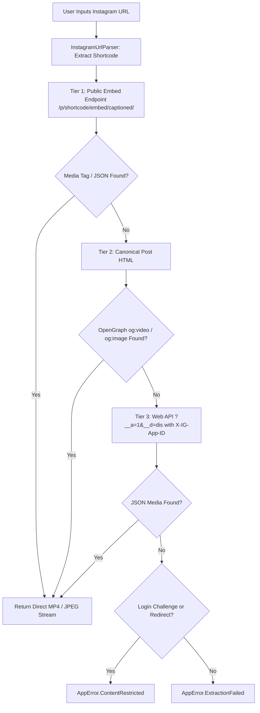

# Instagram Extractor Maintenance & Anti-Bot Strategy

## 1. Web Extraction Fragility Overview

Instagram employs some of the most aggressive anti-scraping and bot-detection systems among major social networks. Key challenges include:
- **Forced Login Walls**: Accessing canonical post URLs (`instagram.com/p/{id}/` or `instagram.com/reel/{id}/`) often redirects unauthenticated requests to `/accounts/login/?next=...`.
- **Private Profiles & Age Restrictions**: Media hosted on private accounts or flagged with age restrictions cannot be retrieved without active user session cookies.
- **Dynamic JavaScript Rendering**: Post content is heavily rendered via React/Relay on the client side, with obfuscated GraphQL and JSON structures that rotate regularly.
- **Rate Limiting & IP Blocking**: Frequent automated requests without human-like delays can result in HTTP 429 or temporary IP challenge blocks.

---

## 2. Multi-Tiered Extraction Strategy

To achieve reliable public extraction while preserving a **zero-telemetry, zero-credential, local-only** design, `InstagramExtractor` uses a 3-tier fallback architecture:



### Tier 1: Public Embed Page
- **URL Pattern**: `https://www.instagram.com/p/{shortcode}/embed/captioned/`
- **Rationale**: The embed endpoint is intended for public third-party iframe embedding. It does not force immediate desktop login walls and serves standalone HTML containing `<video class="EmbeddedMediaVideo" src="...">`, ``, and user caption text.

### Tier 2: Canonical Post HTML (OpenGraph)
- **URL Pattern**: `https://www.instagram.com/p/{shortcode}/` or `https://www.instagram.com/reel/{shortcode}/`
- **Rationale**: Public posts include `<meta property="og:video" content="...">` and `<meta property="og:image" content="...">` in the HTML `<head>` for social preview crawlers.

### Tier 3: Public Web API Fallback
- **URL Pattern**: `https://www.instagram.com/p/{shortcode}/?__a=1&__d=dis`
- **Header**: `X-IG-App-ID: 936619743392459`
- **Rationale**: Official web client endpoint returns lightweight JSON containing media URLs when accessible.

---

## 3. Privacy & Security Contract

1. **Zero Persisted Cookies**: The application never stores session cookies or credentials.
2. **Zero Login Requirements**: Users are never prompted for an Instagram password.
3. **Explicit Error Boundaries**: When a post is private or blocked by login walls, the application cleanly emits `AppError.ContentRestricted` so the user understands why the media cannot be retrieved.

---

## 4. Maintenance Checklist for Developers

When Instagram extraction fails:
1. **Test Embed Endpoint Manually**:
   ```bash
   curl -s -A "Mozilla/5.0 (Windows NT 10.0; Win64; x64) AppleWebKit/537.36" -H "Referer: https://www.instagram.com/" "https://www.instagram.com/p/<shortcode>/embed/captioned/" | grep -o 'https://[^"]*\.mp4[^"]*'
   ```
2. **Verify X-IG-App-ID**:
   If Instagram updates their public web app client ID, inspect `instagram.com` network requests in browser DevTools to find the latest `X-IG-App-ID` value.
3. **Inspect CSS Selectors**:
   Check if the classes `EmbeddedMediaVideo` or `EmbeddedMediaImage` have changed on embed pages.
