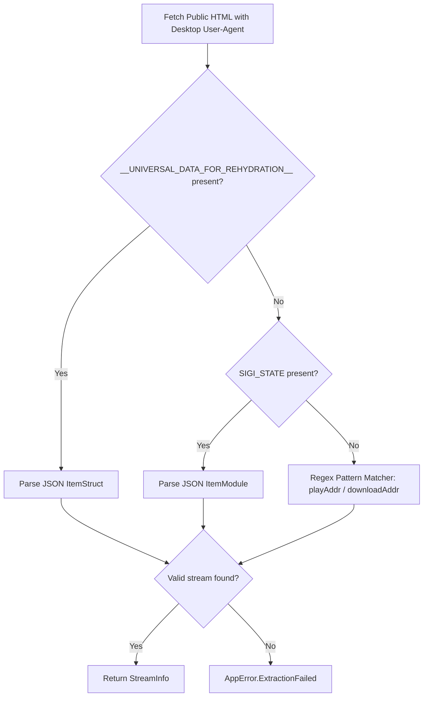

# TikTok Extractor Maintenance & Fragility Notes

## 1. Web Extraction Fragility Overview
TikTok's web interface is dynamic and actively managed to deter automated scraping. Unlike YouTube, which has well-defined deciphering functions, TikTok relies on:
- **Changing Script Element IDs**: Historical transitions from `SIGI_STATE` to `__UNIVERSAL_DATA_FOR_REHYDRATION__` and potentially future script element identifiers.
- **Obfuscated JSON Attributes**: CDN stream URLs (`playAddr`, `downloadAddr`) are embedded with unicode escape sequences (e.g. `\u002F` for `/` and `\u0026` for `&`).
- **Bot Detection & Rate Limiting**: Sending requests with missing or suspicious `User-Agent` headers triggers an HTTP 429 response or redirects to a captcha verification wall (`verify.snssdk.com`).
- **Short URL Redirection**: Mobile users predominantly share `vm.tiktok.com` or `vt.tiktok.com` links which require a multi-hop redirect resolution (up to 3-5 HTTP redirects) to uncover the final canonical video ID.

---

## 2. Multi-Tiered Extraction Strategy
To ensure maximum resilience against HTML schema changes, `TikTokExtractor` uses a 3-tier fallback architecture:



1. **Tier 1 (Primary)**: Searches for `<script id="__UNIVERSAL_DATA_FOR_REHYDRATION__">` and parses `webapp.video-detail.itemInfo.itemStruct`.
2. **Tier 2 (Secondary)**: Searches for `<script id="SIGI_STATE">` and parses `ItemModule[videoId]`.
3. **Tier 3 (Fallback)**: Pattern matches directly on raw unescaped JSON keys:
   - `"playAddr":"..."`
   - `"downloadAddr":"..."`
   - `"cover":"..."`
   - `"desc":"..."`

---

## 3. Watermark Handling
- `downloadAddr` typically contains the original source video uploaded by the creator.
- `playAddr` may contain the watermarked version (`playwm`).
- When available, `downloadAddr` or direct unwatermarked `playAddr` is selected. If only watermarked streams are accessible on the public page, the extractor completes successfully with the available stream rather than failing.

---

## 4. Maintenance Checklist for Developers
When TikTok video extraction fails:
1. **Inspect Public HTML**:
   Fetch a public video URL using `curl` or browser DevTools:
   ```bash
   curl -A "Mozilla/5.0 (Windows NT 10.0; Win64; x64) AppleWebKit/537.36" -L "https://www.tiktok.com/@user/video/<id>"
   ```
2. **Verify Script Tag ID**:
   Check if the `<script id="...">` tag name has been updated by TikTok. If so, add the new pattern to `TikTokExtractor`.
3. **Verify HTTP Status**:
   If receiving HTTP 429, update the `User-Agent` string or increase backoff delay in `RetryPolicy`.
