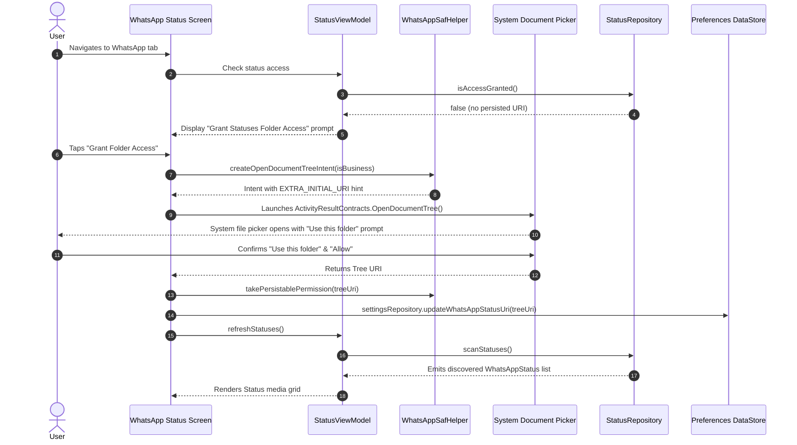

# WhatsApp Status Storage Access Framework (SAF) Grant Flow

## 1. Context: Android 11+ Scoped Storage & .Statuses
Starting with Android 11 (API 30) and continuing through Android 15+, Google strictly prevents apps from accessing raw directory paths in shared storage (e.g. `/sdcard/WhatsApp/Media/.Statuses/` or `/sdcard/Android/media/com.whatsapp/`).
- Direct `java.io.File` calls on these paths throw `SecurityException` or return empty directory listings.
- Personal Media Saver **never requests `MANAGE_EXTERNAL_STORAGE`** (All Files Access), adhering strictly to zero-telemetry and minimal-permission privacy standards.
- Instead, the app uses the official **Storage Access Framework (`ACTION_OPEN_DOCUMENT_TREE`)**.

---

## 2. First-Time Grant Flow



---

## 3. Implementation Details

### Primary & Business Target Paths
- **Standard WhatsApp (Android 11+)**:
  `Android/media/com.whatsapp/WhatsApp/Media/.Statuses`
- **WhatsApp Business (Android 11+)**:
  `Android/media/com.whatsapp.w4b/WhatsApp Business/Media/.Statuses`
- **Legacy Fallback (Android 10 & 9)**:
  `WhatsApp/Media/.Statuses`

### Persisting Read Permissions
When the user grants the folder, the permission must be persisted immediately in the Activity result callback so it survives app termination and device reboots:
```kotlin
context.contentResolver.takePersistableUriPermission(
    treeUri,
    Intent.FLAG_GRANT_READ_URI_PERMISSION
)
```

### Re-Granting Revoked Permissions
If the user clears storage permissions in Android Settings or uninstalls WhatsApp:
1. `WhatsAppSafHelper.hasPersistedPermission(contentResolver, uri)` returns `false`.
2. The app detects the revocation automatically.
3. The UI seamlessly prompts the user to re-grant folder access with a single tap.
